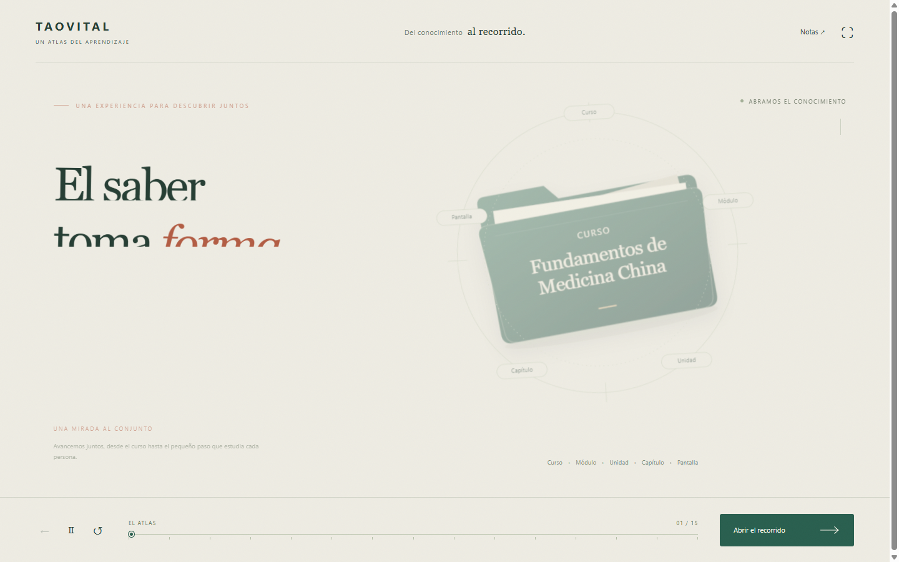

# TaoVital · Un atlas del aprendizaje

Una pieza interactiva de motion graphics con **20 puntos de lectura**. Un único mundo visual: la cámara acompaña una carpeta que se despliega en módulos, unidades, capítulos y pantallas, y después revela el conjunto.

El tono es explicativo y colaborativo. **Sin precios, comparaciones con el año académico ni contenidos de negociación comercial.**



## Abrir

Doble clic en `Abrir_Presentacion.bat` o abre `index.html` en Chrome o Edge. La carpeta completa funciona sin internet ni instalaciones: el motor de animación y los recursos están incluidos localmente.

También puede servirse como cualquier sitio estático:

```powershell
python -m http.server 8080
```

Después abre `http://localhost:8080`.

## Control de la pieza

- **Avanzar / retroceder:** botones, ← / →, espacio, PageUp / PageDown.
- **Pausar / continuar una transición:** botón Ⅱ / ▷ o P.
- **Repetir la transición:** ↺ o R.
- **Explorar fotogramas:** arrastra la línea de tiempo inferior en ambas direcciones.
- **Ir a un nivel:** pulsa Curso / Módulo / Unidad / Capítulo / Pantalla.
- **Inicio / final:** Home / End.
- **Pantalla completa:** ⛶ o F; F11 si el navegador la bloquea.
- **Guion y contexto:** botón Notas.
- **Enlace directo:** `index.html#paso-10`.

Cada transición termina en una pausa estable. No hay avance automático entre puntos. La pregunta del teléfono permite probar ambas alternativas y leer sus explicaciones. No se guardan ni transmiten datos personales.

En computador, las carpetas, capítulos, pantallas, ilustraciones y etapas del proceso reaccionan al cursor con una elevación suave. Las marcas del mosaico se delinean al pasar por ellas. Los hovers se desactivan durante los viajes de cámara y en pantallas táctiles; con movimiento reducido se mantienen los cambios de color sin desplazamientos. No cambian el punto de la presentación ni activan navegación.

Los hovers son solo visuales, sin textos emergentes. Hay únicamente dos tipos de pantalla, **Contenido** y **Pregunta**, intercalados. La retroalimentación es la explicación que aparece al responder dentro de la misma pantalla de pregunta; no es un tercer tipo ni una pantalla adicional.

Después de «El conocimiento se transforma» hay tres planos de producción: preguntas, pantallas conceptuales y recursos visuales. En cada uno, una pieza pasa por cuatro etapas y se despliega el volumen de trabajo con un contador y un mosaico: hasta **395 preguntas**, **315 pantallas conceptuales** y **240 recursos visuales**. Se mantienen las cifras de la propuesta, no se suman como si fueran tres cantidades de pantallas independientes.

El recorrido incorpora además la creación de **guías de estudio en PDF** —selección, síntesis, redacción, corrección, diseño editorial, validación, exportación, optimización y publicación para descarga— y la **capacitación presencial en Temuco** para estudiantes y profesores. La inducción aborda acceso, navegación, estudio, evaluaciones, progreso, orientación y canales de soporte; la propuesta contempla hasta dos instancias por semestre.

## Contenido

Referencia editorial: propuesta privada de Campus Virtual TaoVital, §3.1–3.3. El documento comercial no se publica en este repositorio.

- 12–18 horas activas por curso.
- Hasta 3 módulos, 6 unidades en total, 45 capítulos, 710 pantallas, 395 preguntas y 240 recursos visuales.
- Las distribuciones y nombres temáticos son ejemplos; la malla se define con la escuela.
- Las 710 pantallas: 315 conceptuales + 225 preguntas formativas + 120 de unidad + 50 del integrador. Las evaluaciones de unidad e integrador se suman a las lecciones.
- La guía señala que deben conciliarse las cantidades de evaluación de unidad del documento y las reglas actuales de Zhen antes de producir.
- Las ilustraciones incluidas son recursos reales del proyecto Zhen, no capturas ni una promesa de contenidos específicos.

## Implementación y edición

- `presentation.js`: contenido (`sceneData`), objetos SVG, posiciones (`states`) y una línea de tiempo maestra GSAP con cámara continua. Los objetos se crean una sola vez y mantienen su identidad.
- `styles.css`: dirección visual, composición y adaptación de pantalla.
- `vendor/gsap.min.js`: GSAP 3.14.2, distribución local; conserva su encabezado de licencia.
- `assets/`: muestras de arte de Zhen.
- `REFERENCIAS.md`: investigación, decisiones y procedencia de recursos.
- `qa/`: scripts de verificación y registro de revisión. Las capturas temporales no se versionan.

Durante el desarrollo se consultaron los skills oficiales `gsap-core` y `gsap-timeline`; no son necesarios para ejecutar la presentación y no se distribuyen aquí.

Respeta movimiento reducido: salta directamente al punto de lectura en lugar de mover la cámara. Al abrir el proyecto no se consulta ningún CDN, fuente remota o API.

## Avisos

GSAP mantiene su propia licencia; consulta `NOTICE.md`. El contenido académico, la identidad TaoVital y los recursos visuales incluidos conservan sus derechos correspondientes. La publicación del código no implica una licencia adicional sobre esas marcas o contenidos.
